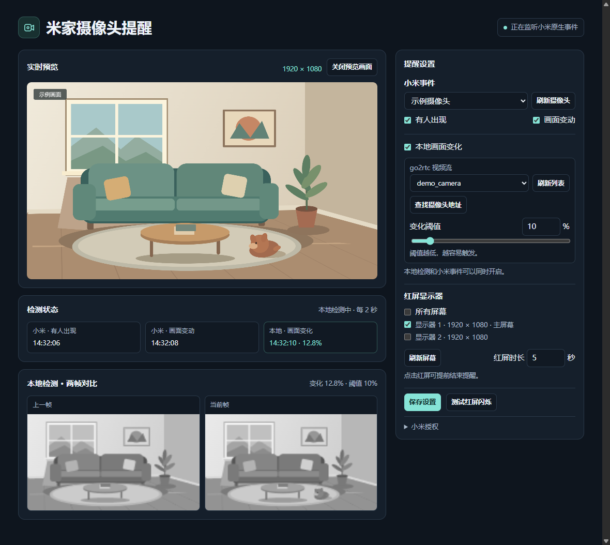

# 米家摄像头提醒

Windows 本机网页。用摄像头的画面变化或小米云事件触发指定屏幕闪红，支持实时预览。



## 启动

需要 Windows x64 和 [Node.js 26](https://nodejs.org/)。在项目目录运行：

```powershell
npm ci --ignore-scripts
npm start
```

打开[本机提醒页](http://127.0.0.1:18733/)，选择红屏显示器和时长，点「保存设置」。终端按 `Ctrl+C` 停止。

## 本地检测和预览

1. 下载 [go2rtc Windows x64 版](https://github.com/AlexxIT/go2rtc/releases)，放到单独的目录，同目录创建 `go2rtc.yaml`：

   ```yaml
   api:
     listen: "127.0.0.1:1984"
   rtsp:
     listen: ""
   webrtc:
     listen: ""
   srtp:
     listen: ""
   ```

2. 在 go2rtc 目录运行 `.\go2rtc.exe -config .\go2rtc.yaml`。H.264/H.265 抓图需要让 go2rtc 能找到 FFmpeg。 [抓图说明](https://github.com/AlexxIT/go2rtc/blob/v1.9.15/internal/mjpeg/README.md)
3. 打开 [go2rtc 添加设备页](http://127.0.0.1:1984/add.html)，选 **Xiaomi** 登录，选择账号所在地区并添加摄像头视频流。 [小米接入说明](https://github.com/AlexxIT/go2rtc/blob/v1.9.15/internal/xiaomi/README.md)
4. 回提醒页勾选「本地画面变化」，选视频流并保存。默认阈值 **10%**，越低越灵敏。点「打开摄像头预览」查看原分辨率视频，默认静音。

go2rtc v1.9.15 验证后若账号列表为空，可在项目外给 go2rtc 源码应用补丁，再运行 `go build -o go2rtc.exe .`。 [PR #2582](https://github.com/AlexxIT/go2rtc/pull/2582)

## 小米云事件（可选）

展开「小米授权」，授权后把浏览器回跳的完整地址粘贴到提醒页。选摄像头，勾选「有人出现」或「画面变动」并保存。可以和本地检测一起用，也可以单独用。

云事件为实验性功能，复用 Xiaomi Home 的 Home Assistant 授权接口，目前已在中国大陆区验证。 [授权回跳说明](https://github.com/XiaoMi/ha_xiaomi_home/wiki/OAuth-2.0-login-when-Home-Assistant-URL-is-not-homeassistant.local%3A8123)

[MIT 许可证](LICENSE)
